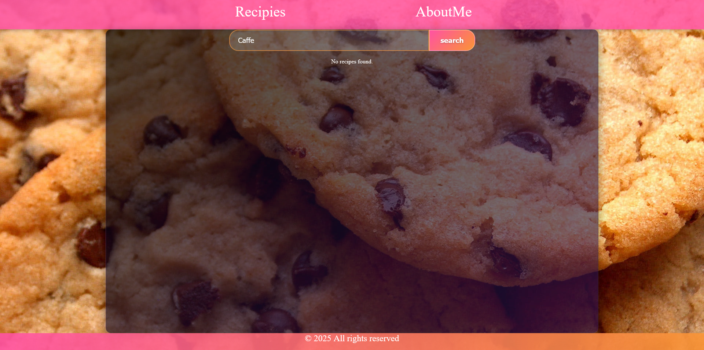
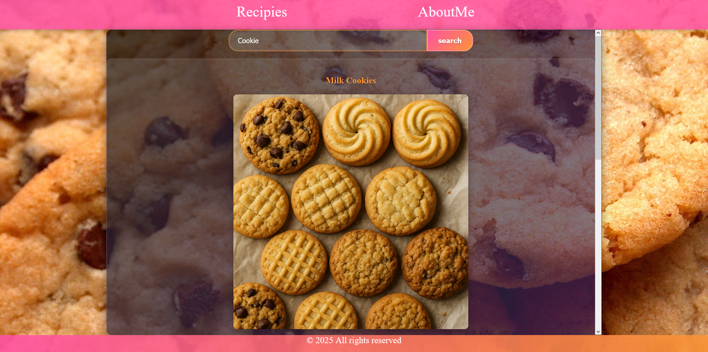

# Recipe Blog – Django

This project is a simple recipe blog written in Django. It allows browsing, searching, and adding new recipes via the admin panel.

## Features

- Browse the list of recipes
- Search recipes by keyword
- View recipe details with a photo
- Admin panel for managing recipes

## Example of the search engine

Below are two examples of the search engine in action:

### 1. Searching for a recipe that does not exist (`caffe`)



As you can see, the message `No recipes found.` appears because there is no recipe with such a keyword.

### 2. Searching for a cookie recipe (`cookie`)



The search result shows the milk cookie recipe.

## Adding a new recipe

To add a new recipe:

1. Go to the admin panel:  
   [http://127.0.0.1:8000/admin/BlogApp/article/add/](http://127.0.0.1:8000/admin/BlogApp/article/add/)
2. Fill in the form fields.  
   **Example for keywords:**
   ```
   ["Cookie", "Milk Cookie"]
   ```
3. Save the recipe.

## Installation

1. Install the required packages:
   ```
   pip install -r requirements.txt
   ```
2. Run migrations:
   ```
   python manage.py migrate
   ```
3. Start the development server:
   ```
   python manage.py runserver
   ```
